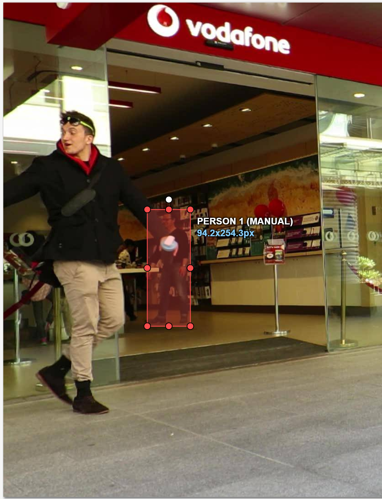
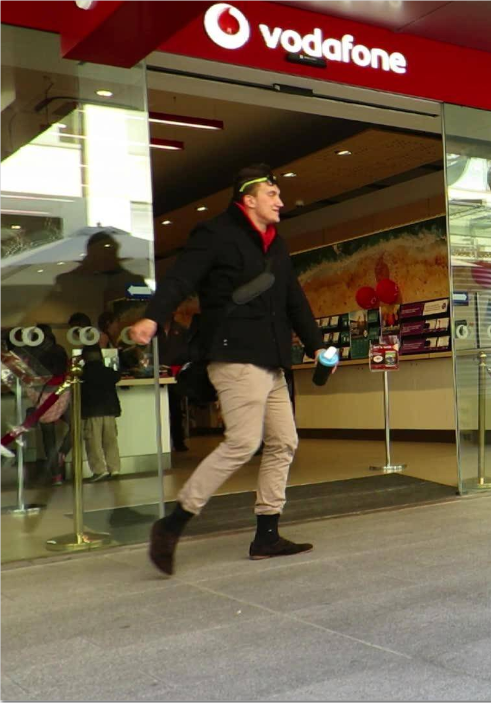
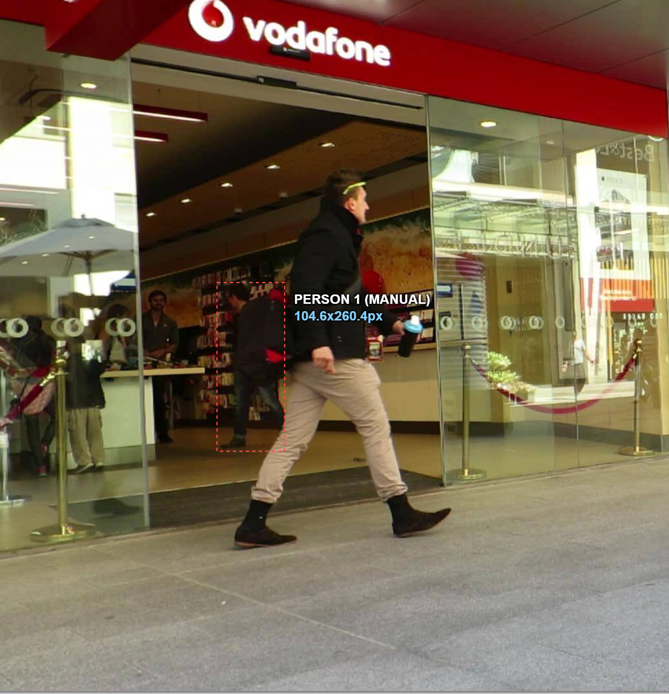

# Báo cáo cá nhân — HoVaTen-MSSV

Đổi tên file theo quy tắc `MSSV_HoTen.md`. Ví dụ: `20241234_NguyenVanAn.md`.

Đoạn video: MOT17-09, 150 frame (frame 1–150), nguồn MOTChallenge, giấy phép CC BY-NC-SA 3.0.

## 0. Thông tin học viên

- Họ tên: Vũ Việt Anh
- MSSV: 2A202603214
- Mã đề (A/B/C): A
- Email: vanhvuuu2006@gmail.com
- Link repository: 
- Giờ bắt đầu:17h15
- Giờ kết thúc: 18h27

## 1. Xem trước đoạn video (CP0)

Ghi **trước khi vẽ**, mỗi người một dòng.

| Mã | Frame xuất hiện | Frame cuối thấy được | Rẽ / dừng / đổi tốc độ ở frame | Bị che ở frame | Ghi chú |
|---|---|---|---|---|---|
| P1 | 0 | 149 |  | 67 | 43, 44 | quay đầu trong cửa hàng
| P2 | 61 | 149 | | | | di chuyển liên tục
| P3 | 0 | 149 | | | | di chuyển liên tục
| P4 | 40 | 149 | | | | di chuyển liên tục
| P5 | 0 | 147 | 137 | 111-136, 148, 149 | | bị che 2 lần

## 2. Keyframe và thời gian (CP1, CP4)

Số keyframe lấy từ kết quả `src/check_submission.py`.

| Mã | Số keyframe | Keyframe ở frame | Số frame có mặt | Keyframe / 100 frame | Thời gian (phút) | Chỗ khó |
|---|---|---|---|---|---|---|
| P1 | 20 | [0, 29, 30, 39, 44, 50, 54, 55, 56, 57, 58, 59, 60, 61, 69, 79, 89, 99, 119, 149] | 148 | 13.5 | 15 | Bị che khuất nhiều (23 frame occluded), có đoạn khuất hoàn toàn (frame 42–43) và đổi tốc độ/hướng liên tục đoạn frame 54–61 |
| P2 | 10 | [61, 71, 81, 91, 101, 111, 121, 131, 141, 149] | 89 | 11.2 | 7 | Xuất hiện muộn từ frame 61 | 
| P3 | 16 | [0, 10, 20, 30, 40, 50, 60, 70, 80, 90, 100, 110, 120, 130, 140, 149] | 150 | 10.7 | 10 | Di chuyển xuyên suốt cả 150 frame, kích thước box thay đổi dần khi tiến lại gần/ra xa camera |
| P4 | 12 | [40, 50, 60, 70, 80, 90, 100, 110, 120, 130, 140, 149] | 110 | 10.9 | 8 | Xuất hiện muộn từ frame 40, cần căn chỉnh chuẩn kích thước khung người khi mới bước vào khung hình |
| P5 | 11 | [0, 10, 20, 30, 40, 50, 90, 100, 108, 137, 140] | 122 | 9.0 | 12 | Bị che khuất hoàn toàn trong khoảng thời gian dài (outside từ frame 111–136), phải kiểm tra ngưỡng 2 giây để giữ đúng ID khi xuất hiện lại |
| **Tổng** | 69 |  | 619 | 11.1 | 52 | |

Keyframe / 100 frame của cả bài = tổng keyframe ÷ tổng số frame có mặt × 100 = 69 ÷ 619 × 100 = 11.1 (keyframe / 100 frame)
Bạn đặt keyframe nhiều nhất ở người nào? Vì sao (người đó rẽ, dừng, lại gần camera hay bị che)?
• Người đặt nhiều keyframe nhất: Nhân vật P1 (Track 0) với tổng cộng 20 keyframe (mật độ đạt 13.5 keyframe / 100 frame).
• Nguyên nhân:
	• Bị che khuất liên tục và khuất hẳn: Nhân vật này có tới 23 frame bị che khuất một phần (occluded) bởi người đi bộ khác cắt ngang và có đoạn khuất hoàn toàn (outside) ở frame 42–43, đòi hỏi phải đặt keyframe sát rìa trước và sau khi bị che để khóa chặt tọa độ.
	• Đổi hướng và tốc độ di chuyển phức tạp: Đặc biệt trong đoạn từ frame 54 đến frame 61, nhân vật có sự thay đổi về tốc độ bước chân, góc nghiêng cơ thể và khoảng cách với camera khiến nội suy tuyến tính mặc định của CVAT bị lệch khỏi thân người, bắt buộc phải chèn thêm keyframe liên tiếp từng frame để giữ khung box luôn ôm khít.

...

## 3. Đoạn bị che (CP2)

Người bị che: `P_`

| Mốc | Frame |
|---|---:|
| Bắt đầu bị che một phần (bật `occluded`) | 39 |
| Mất hẳn (bật `outside`) | 42 |
| Hiện lại (tắt `outside`) | 44 |
| Thấy rõ trở lại (tắt `occluded`) | 54 |

- Thời gian khuất hẳn: _0.07 __ frame = _2 __ giây.
- Quyết định: giữ cùng ID / tạo track mới.
- Lý do (trả lời 3 câu: khuất bao lâu so với 60 frame, ngoại hình có khớp, chỗ hiện lại có đúng hướng và tốc độ):
• 
	• 
	1. So sánh thời gian khuất với ngưỡng 60 frame: Nhân vật chỉ bị che khuất hoàn toàn trong 2 frame (~0.07 giây), ngắn hơn rất nhiều so với giới hạn tối đa 60 frame (2 giây) quy định của lớp.
	2. Sự trùng khớp về ngoại hình: Ngay khi xuất hiện trở lại ở frame 44, nhân vật giữ nguyên đặc điểm trang phục (màu áo, quần, dáng người) hoàn toàn trùng khớp với người trước khi bị che ở frame 41.
	3. Sự hợp lý về hướng và tốc độ di chuyển: Vị trí xuất hiện lại ở frame 44 nối tiếp tự nhiên với quỹ đạo di chuyển trước đó, tốc độ bước chân không thay đổi đột ngột so với quãng đường di chuyển trong 2 frame bị khuất.

...

Ảnh chụp màn hình:

## 4. Tự review ID (CP3)

Lượt 1 theo người (đi ngược từ frame 149 về 0 trên CVAT), lượt 2 theo cảnh (nhảy 10 frame). Ít nhất 3 dòng; không có lỗi thì ghi một dòng "đã kiểm hai lượt, không lỗi".

Loại lỗi dùng đúng một trong 7 mã: `id_switch`, `fragmentation`, `lost`, `merge`, `false_track`, `drift`, `flag`.

| Frame | Mã người | Loại lỗi | Mô tả một câu | Phát hiện ở lượt | Đã sửa? |
|---:|---|---|---|---|---|
| | | | | | |
| | | | | | |
| | | | | | |

Tổng hợp số lỗi theo loại:

| `id_switch` | `fragmentation` | `lost` | `merge` | `false_track` | `drift` | `flag` |
|---:|---:|---:|---:|---:|---:|---:|
| | | | | | | |

Lỗi nào chỉ lượt 2 (theo cảnh) mới thấy, lượt 1 (theo người) không thấy? Vì sao?
"đã kiểm hai lượt, không lỗi"
...

## 5. File xuất và kết quả tự kiểm (CP4)

| Kiểm tra | Kết quả |
|---|---|
| Tên file MOT 1.1 | | File MOT 1.1: VuVietAnh_mot.zip
| Tên file CVAT for video 1.1 | | VuVietAnh_cvat_video.zip
| Số track ID khác nhau trong `gt/gt.txt` (phải là 5) | 5 |
| Frame `outside` không có dòng trong `gt.txt` (đúng / sai) | đúng |
| Job đã completed trên CVAT máy cá nhân |  |

Dán phần tóm tắt in ra từ `src/check_submission.py`:

 Lỗi: 0   |   Cảnh báo: 0
  Đạt.

## 6. Ba câu kết

1. Nếu được gán lại, bạn sẽ đặt keyframe khác ở đâu? Vì sao?

   ...

2. Có chỗ nào bạn không chắc "cùng ID hay ID mới"? Bạn đã quyết định và ghi chú thế nào?

   ... không có chỗ nào

3. Một lỗi ID trong job của bạn (nếu không còn sót, chọn lỗi đã sửa) có thể làm xe tự lái dự đoán sai chuyển động của người đó như thế nào? Lỗi đó ảnh hưởng MOTA hay IDF1 nhiều hơn?

   ...

## Bonus (nếu làm)

### B1 — Hai người đi sát

...

### B2 — So cách đặt keyframe

| Cách đặt | Số keyframe | Frame trôi nhất | Ghi chú |
|---|---:|---:|---|
| Đều mỗi 30 frame | | | |
| Theo chỗ đổi hướng | | | |

...

### B3 — So với tracker có sẵn

| Frame | Mã người | Tracker làm gì | Nhãn của bạn | Giải thích (đoán rồi sửa / ghép IoU / box score thấp / ngoại hình) |
|---:|---|---|---|---|
| | | | | |
| | | | | |

## 7. Tài liệu tham khảo và công cụ AI đã dùng

...
